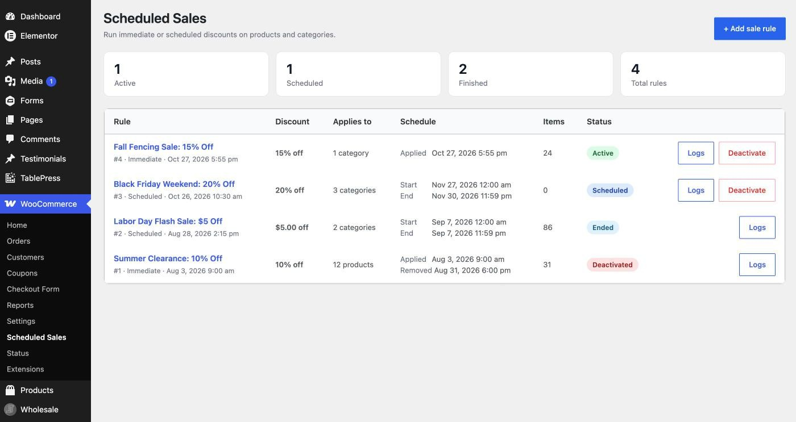
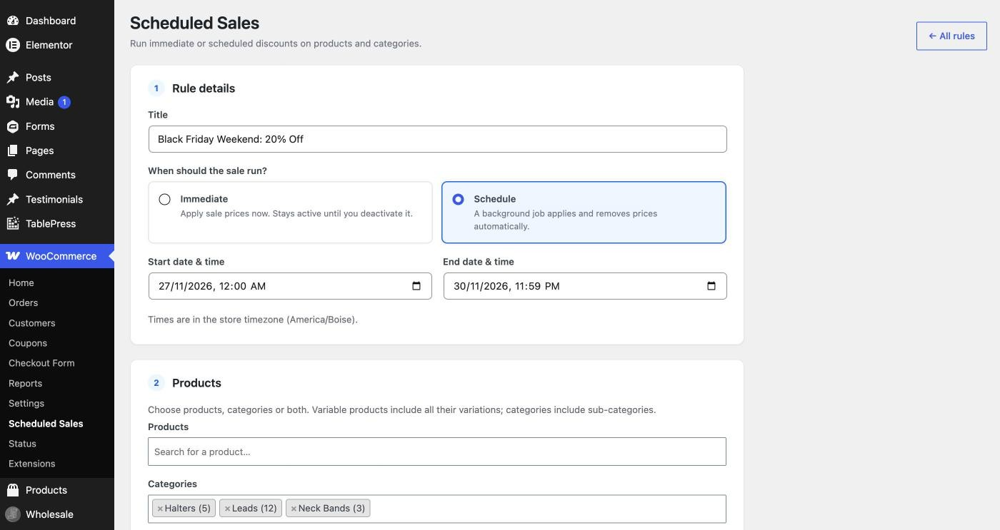
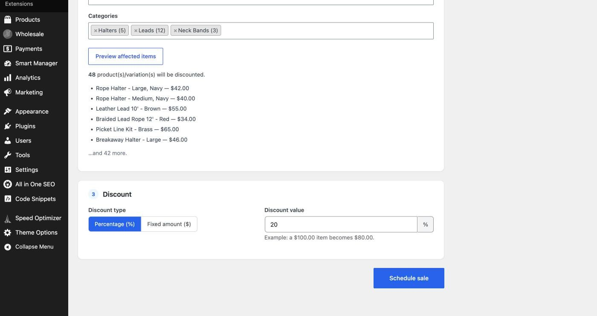
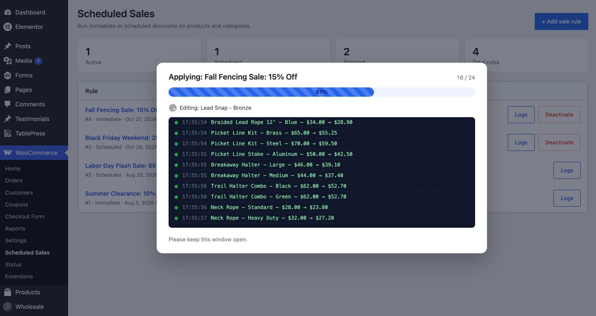
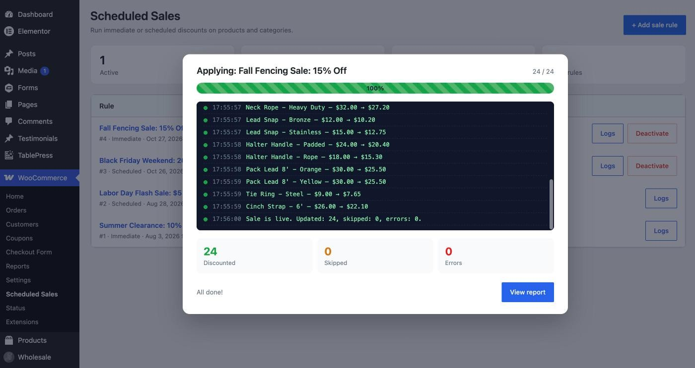
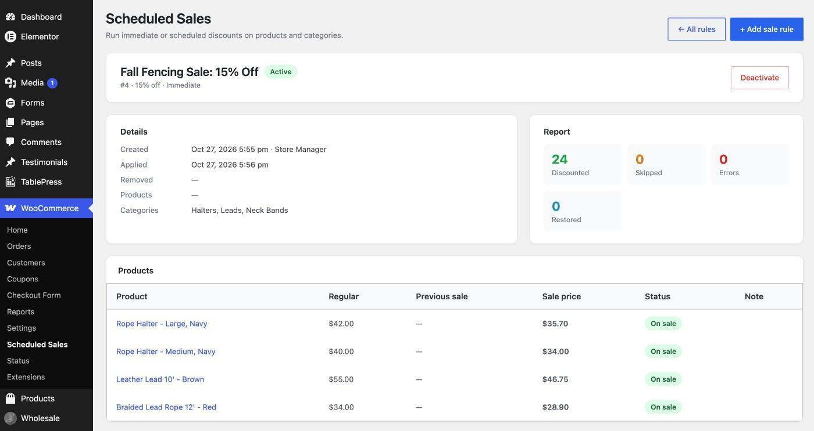
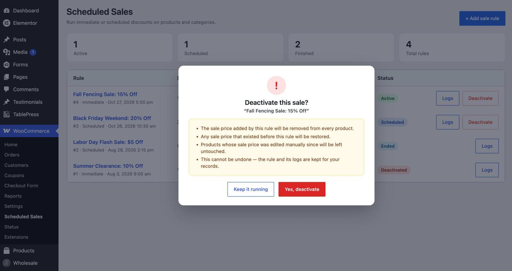
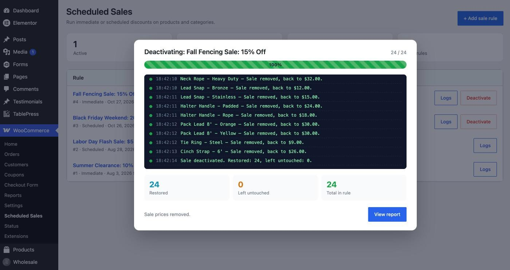

# GFF Scheduled Sales for WooCommerce

Run sales on your WooCommerce store without editing prices by hand. Create a sale rule, pick products or categories, choose a percentage or fixed discount, and either apply it now or schedule it. A background job puts the sale on and takes it off at the times you set. Every sale keeps a full report and activity log.

Built by [Get Found First](https://getfoundfirst.com/).


## Contents

- [Features](#features)
- [Screenshots](#screenshots)
- [Requirements](#requirements)
- [Installation](#installation)
- [How to use it](#how-to-use-it)
- [How it works](#how-it-works)
- [Safety rules](#safety-rules)
- [Background jobs and cron](#background-jobs-and-cron)
- [Data and records](#data-and-records)
- [For developers](#for-developers)
- [FAQ](#faq)
- [Changelog](#changelog)
- [License](#license)

## Features

- **Many sale rules.** Each rule has its own title, products, discount and schedule.
- **Immediate or scheduled.** Apply a sale right now, or set a start and end date and let it run on its own.
- **Products, categories, or both.** Categories include their sub-categories. Variable products include every variation.
- **Percentage or fixed discount.** For example, 15% off or $5 off. Prices round to your store's decimal setting.
- **Preview before you publish.** See how many items will change and a sample of them.
- **Live progress.** When you publish an immediate sale, a progress bar and log show each product as it updates, then a report.
- **Deactivate any time.** One click removes the sale price after a clear warning, with the same live progress and report.
- **Restores what was there before.** If a product already had a sale price or sale dates, they come back when the rule ends.
- **Leaves manual edits alone.** If someone changed a sale price by hand while the rule was running, the plugin skips that product and logs it.
- **Full records.** Every rule keeps a product table, a report and a time-stamped activity log. Nothing is deleted.

## Screenshots

### 1. All sale rules in one place

*The rules list. Counts for active, scheduled and finished sales sit on top. Each row shows the discount, what it applies to, the schedule, how many items changed and the status. Active and scheduled rules have a Deactivate button.*

### 2. Create a rule: name and timing

*Give the rule a title and choose Immediate or Schedule. Scheduled rules need a start date in the future and an end date after the start. Times use the store timezone.*

### 3. Create a rule: products and discount

*Pick products, categories, or both. "Preview affected items" shows the item count and a sample before anything changes. Choose a percentage or fixed amount; the example under the field shows what a $100 item would cost.*

### 4. Live progress while a sale is applied

*Publishing an immediate sale opens a progress window. It shows which product is being edited, the old and new price for each item, and a running count.*

### 5. Report when it finishes

*When the run ends you get a summary: how many items were discounted, skipped or failed. "View report" opens the rule's detail page.*

### 6. Rule detail page

*Each rule has a detail page with its dates, who created it, a report, and a table of every product with its regular price, previous sale price, new sale price and status. The activity log sits below.*

### 7. Warning before deactivating

*Deactivating always shows a warning first. It explains what will happen. For a scheduled rule that has not started yet, it explains that the jobs will be cancelled and no prices will change.*

### 8. Deactivation progress and report

*Deactivation runs with the same progress window. It shows each price going back, and a report of how many items were restored or left untouched.*

## Requirements

| | Minimum |
|---|---|
| WordPress | 6.0 |
| WooCommerce | 7.0 (tested up to 11.2) |
| PHP | 7.4 |
| User capability | `manage_woocommerce` (Shop Manager or Administrator) |

The plugin declares compatibility with WooCommerce High-Performance Order Storage (HPOS). It does not touch orders.

## Installation

1. Download this repository as a ZIP, or copy the `gff-scheduled-sales` folder.
2. In WordPress, go to **Plugins → Add New → Upload Plugin**, upload the ZIP and activate it.
   Or upload the folder to `wp-content/plugins/` and activate it from **Plugins**.
3. On activation the plugin creates three database tables (see [Data and records](#data-and-records)).
4. Open **WooCommerce → Scheduled Sales**.

You can also install it with WP-CLI:

```bash
wp plugin install gff-scheduled-sales.zip --activate
```

The `screenshots/` folder is only for this README. You don't need them on a live site.

## How to use it

### Run a sale now

1. Go to **WooCommerce → Scheduled Sales** and click **+ Add sale rule**.
2. Enter a title, for example `Fall Halter Sale: 15% Off`.
3. Leave **Immediate** selected.
4. Pick products, categories, or both. Click **Preview affected items** to check the list.
5. Choose **Percentage** or **Fixed amount** and enter the value.
6. Click **Publish sale**. Keep the window open while the progress bar runs. You'll see a report at the end.

The sale stays on until you deactivate it.

### Schedule a sale

1. Follow the steps above, but choose **Schedule**.
2. Set a **start** date and time (must be in the future) and an **end** date and time (must be after the start).
3. Click **Schedule sale**.

Nothing changes until the start time. At the start time a background job applies the sale. At the end time another job removes it. Both runs are written to the rule's activity log.

### Deactivate a sale

Click **Deactivate** on the rule (in the list or on its detail page) and confirm the warning.

- **Active rule:** the sale price is removed from every product it changed, with live progress and a report. Any scheduled end job is cancelled.
- **Scheduled rule that has not started:** the start and end jobs are cancelled. No product prices change.

The rule and its logs stay in the list for your records.

## How it works

### Which items get a sale price

The plugin turns your selection into a list of items that have their own price:

| You select | What gets the sale price |
|---|---|
| A simple or external product | That product |
| A variable product | Every variation of it |
| A single variation | That variation |
| A category | Every product in it and its sub-categories (published, private, draft, pending and future products) |
| A grouped product | Skipped. Grouped products have no price of their own. |

If an item is selected twice (for example, directly and through a category), it is only changed once.

### Price calculation

- **Percentage:** `sale = regular × (1 − value / 100)`
- **Fixed:** `sale = regular − value`

The result rounds to the number of decimals set in **WooCommerce → Settings → General**. The sale price is written to the product's normal WooCommerce **Sale price** field, so the theme, cart, checkout and feeds all see it as a standard WooCommerce sale.

While a rule is active, any sale dates already on the product are cleared so the rule's price applies right away. They are restored when the rule ends.

### Apply flow

1. The rule is saved, and the target list is built and stored on the rule as a queue.
2. The queue is processed in small batches: **5 items per request** in the browser, **25 items per background job**.
3. For each item the plugin records the regular price, the previous sale price and previous sale dates, then writes the new sale price.
4. Variable parents are re-synced after their variations change, so price ranges on the shop page are correct.
5. When the queue is empty, product caches are cleared. If SiteGround Optimizer is installed, its cache is purged too.

### Deactivate and end flow

1. Every item the rule changed is queued.
2. For each item, the plugin checks that the current sale price still matches the price the rule set.
   - **It matches:** the previous sale price and sale dates are restored, or the sale price is cleared if there wasn't one.
   - **It doesn't match:** the item is left alone and logged as *Left untouched*.
3. The rule is marked **Deactivated** (manual) or **Ended** (scheduled end).

### Rule statuses

| Status | Meaning |
|---|---|
| Scheduled | Waiting for its start time. No prices changed yet. |
| Applying… | Sale prices are being written. |
| Active | Sale is live. |
| Deactivating… | Sale prices are being removed. |
| Ended | A scheduled sale reached its end time and was removed. |
| Deactivated | Someone turned the sale off. |
| Cancelled | A scheduled sale was turned off before it started. |

## Safety rules

- **One rule per item.** If an item is already on sale through another active rule, it is skipped with a note naming that rule.
- **No negative or zero prices.** If a fixed discount is larger than the price, the item is skipped.
- **No regular price, no sale.** Items without a regular price are skipped.
- **Percentage must be below 100.**
- **Dates are checked twice,** in the browser and again on the server. The start must be in the future and the end must be after the start.
- **Manual edits win.** If a sale price was changed by hand while the rule was active, deactivation leaves it alone.
- **No double processing.** A per-rule lock stops the browser and the background job from working on the same items at once.
- **Closed browser? No problem.** When you publish or deactivate, a backup job is scheduled 2 minutes later. If you close the tab mid-run, the background job finishes the rest. You can also click **Show progress** on the rule to pick it back up.
- **Permissions.** Every screen and request needs the `manage_woocommerce` capability and a valid nonce.

## Background jobs and cron

Scheduled work uses **Action Scheduler**, the job queue that ships with WooCommerce. You don't need anything extra. Jobs show up under **Tools → Scheduled Actions**, in the group `gff-scheduled-sales`.

| Hook | When it runs |
|---|---|
| `gff_ss_start_rule` | At a scheduled rule's start time. Applies the sale. |
| `gff_ss_end_rule` | At a scheduled rule's end time. Removes the sale. |
| `gff_ss_continue` | Processes the next batch for large rules, and acts as the backup job for browser runs. |

Action Scheduler runs on WP-Cron, and WP-Cron runs when someone visits the site. On a quiet site a sale can start or end a few minutes late. To run on time, use a real server cron and turn off the visitor-triggered one:

```php
// wp-config.php
define( 'DISABLE_WP_CRON', true );
```

```bash
# Every minute
* * * * * cd /path/to/site && wp cron event run --due-now > /dev/null 2>&1
```

If a scheduled end time passes while the sale is still being applied, the plugin removes the sale right after applying finishes.

## Data and records

The plugin creates three tables (shown with the default `wp_` prefix):

| Table | What it holds |
|---|---|
| `wp_gff_ss_rules` | One row per rule: title, mode, dates, products, categories, discount, status, queue, who created and deactivated it, and when. |
| `wp_gff_ss_items` | One row per item a rule touched: regular price, previous sale price and dates, new sale price, status and note. This is what makes a clean restore possible. |
| `wp_gff_ss_logs` | The activity log: every step, with time, level (info, success, warning, error) and message. |

Times are stored in UTC and shown in the store timezone.

Records are never deleted, including when the plugin is deactivated. To remove the data completely, drop the three tables and delete the `gff_ss_db_version` option.

**Before you deactivate the plugin itself,** deactivate any active sale rules first. Otherwise the sale prices they set stay on the products. They are normal WooCommerce sale prices, so you can still remove them by hand.

## For developers

### Action

```php
/**
 * Fires after a rule finishes applying or removing prices,
 * once product caches have been cleared.
 */
do_action( 'gff_ss_prices_changed' );
```

Use it to clear other caches or trigger a feed refresh:

```php
add_action( 'gff_ss_prices_changed', function () {
	// e.g. purge a CDN, regenerate a product feed
} );
```

### File structure

```
gff-scheduled-sales/
├── gff-scheduled-sales.php          Plugin header, bootstrap, HPOS declaration
├── includes/
│   ├── class-gff-ss-install.php     Table creation and upgrades (dbDelta)
│   ├── class-gff-ss-engine.php      Rules, targeting, apply/revert, queue, locks, background jobs
│   └── class-gff-ss-admin.php       Admin pages, AJAX endpoints, modals
├── assets/
│   ├── admin.css                    Admin styles
│   └── admin.js                     Form validation, preview, progress runner, deactivate dialog
└── screenshots/                     README screenshots
```

### AJAX endpoints

All endpoints use `admin-ajax.php`, need the `gff_ss` nonce and the `manage_woocommerce` capability.

| Action | Purpose |
|---|---|
| `gff_ss_preview` | Count and sample the items a selection would change. Read only. |
| `gff_ss_create` | Validate and save a rule. Immediate rules are queued to apply. |
| `gff_ss_batch` | Process the next batch of a rule's queue and return log lines and progress. |
| `gff_ss_deactivate` | Cancel a scheduled rule, or queue an active rule for removal. |

### Prefix

Everything uses the `gff_ss` / `GFF_SS` / `gff-ss` prefix: functions, classes, options, hooks, tables, CSS classes and the text domain `gff-scheduled-sales`.

## FAQ

**Will customers see the sale like a normal WooCommerce sale?**
Yes. The plugin writes the standard WooCommerce sale price, so the "Sale" badge, crossed-out regular price, cart and checkout all work as usual.

**Can I edit a rule after publishing it?**
No. Deactivate it and create a new one. This keeps the record of each sale accurate.

**What if two rules include the same product?**
The first rule to apply wins. The second rule skips that product and notes which rule already has it.

**I closed the browser while a sale was applying. What happens?**
The backup job finishes it within a few minutes. You can also open the rule and click **Show progress**.

**Does it work with wholesale or role-based pricing plugins?**
It only changes the standard WooCommerce sale price. Plugins that store their own price fields aren't affected.

**My scheduled sale started a few minutes late.**
That's WP-Cron waiting for a site visit. Set up a real server cron (see [Background jobs and cron](#background-jobs-and-cron)).

## Changelog

### 1.0.3
- Fixed: the "View report" button showed while a sale was still processing.

### 1.0.2
- Added space below the progress bar in the progress window.

### 1.0.1
- Cancelling a scheduled rule now shows "Schedule cancelled, no prices were changed" instead of the removal message.

### 1.0.0
- First release: immediate and scheduled sale rules, product and category targeting, percentage and fixed discounts, live progress, deactivation with restore, reports and activity logs.

## License

GPLv2 or later. See [gnu.org/licenses/gpl-2.0.html](https://www.gnu.org/licenses/gpl-2.0.html).

---

Made by **[Get Found First](https://getfoundfirst.com/)**.
